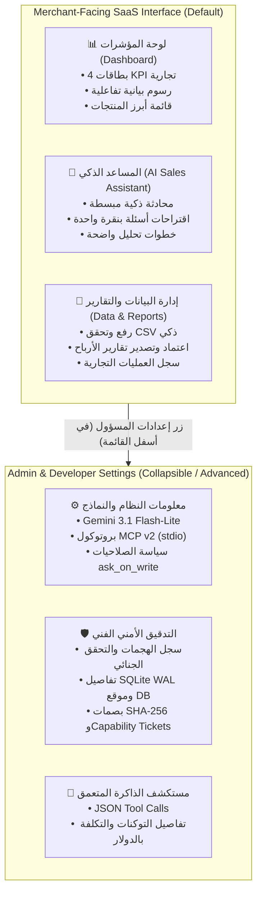

# RetailMind AI — End-User Product & Interface Audit

**Auditor Role:** Senior Product Manager, UX Auditor & SaaS Quality Engineer  
**Target Persona:** Nontechnical Retail Business Owner (Store Owner, Retail Manager, Commercial Director)  
**Audit Scope:** Full Application End-to-End Walkthrough across 5 Views & Navigation  
**Audit Methodology:** Automated Playwright Real-Browser Inspection, DOM Analysis, Bilingual Language Review (Arabic RTL & English LTR), Responsive Breakpoints (Desktop, Tablet, Mobile)  
**Mode:** READ-ONLY AUDIT — Zero code, CSS, or configuration modifications made. Zero paid API calls.

---

## 1. Executive Summary

### The Merchant's Dilemma
**RetailMind AI** has achieved remarkable visual elegance in its latest iterations—reproducing the ivory, white, navy, and emerald SaaS palette of the reference designs. However, beneath this polished exterior, the application frequently speaks the language of **an AI/software engineer preparing for an academic capstone defense**, rather than the language of **a retail merchant trying to understand why their profits dropped this month**.

When a commercial store owner logs into RetailMind AI today, they are immediately confronted with:
1. **Developer Architecture Badges:** Terms like `MCP v2 (stdio)`, `Gemini 3.1 Flash-Lite`, and `ask_on_write` prominently displayed under the logo.
2. **Cryptographic & Database Leaks:** 64-character SHA-256 dataset hashes, raw UUID user IDs (`user_b287b0c47e69`), hardcoded Windows disk paths (`C:\Users\HP\Desktop\...\data\audit.db`), and mentions of `SQLite WAL mode`.
3. **Decorative Non-Functional Traps:** Date filter pills with dropdown arrows (`▼`) that cannot be clicked, static hardcoded greetings (`مرحباً أحمد`), and dates locked to `27 أكتوبر 2025`.
4. **Duplicate & Confusing Controls:** Sample dataset loaders scattered across the sidebar, overview page, and dataset page; developer password inputs embedded directly into the CSV upload expander; and raw JSON tool payloads shown in historical memory.

### Strategic Verdict
RetailMind AI possesses **a first-rate analytical core** (deterministic calculations, strict 50,000-row limits, finite math safeguards, and capability-ticket authorization). To transition from an impressive technical capstone to a **marketable, intuitive enterprise SaaS product**, it must adopt a **Strict Separation of Concerns**:
- **Merchant Surface:** Clean, business-centric language, automated insight cards, intuitive uploads, and actionable financial metrics.
- **Admin / Developer Drawer:** Technical logs, token usage, MCP connection diagnostics, database paths, and model configurations securely moved into an expandable "الإعدادات المتقدمة" (Advanced Settings) view.

---

## 2. Complete Audit Findings Table

| ID | Page / Area | UI Element | Problem Description | User Impact | Recommendation | Priority | Evidence / Code Reference |
|---|---|---|---|---|---|---|---|
| **NAV-01** | Global Sidebar | Top Architecture Badges | Displays `● Gemini 3.1 Flash-Lite`, `● بروتوكول MCP v2 (stdio)`, `● سياسة ask_on_write` under the logo. | Retailers do not know what MCP, stdio, or model codes mean. Creates cognitive overload and looks like an unconfigured developer test environment. | **MOVE TO ADVANCED** / Replace with a single merchant badge: `● متصل بالذكاء الاصطناعي` (AI Connected) or `● جاهز لتحليل المبيعات`. Move technical specs to an "About" modal. | **P1** | `app.py:692-700`<br>Screenshot: `audit_12_sidebar_expanded.png` |
| **NAV-02** | Global Sidebar | Session Data Expander | Expander `📁 بيانات الجلسة النشطة` displays raw SHA-256 fingerprint (`753228f2...`) and technical dataset badges. | Intimidates nontechnical merchants with raw cryptography hashes that have zero commercial meaning. | **SIMPLIFY** / Display only the human-readable file name (`synthetic_sales.csv`) and row count. Move SHA-256 fingerprint to an advanced details drawer. | **P2** | `app.py:741-754`<br>Screenshot: `audit_12_sidebar_expanded.png` |
| **NAV-03** | Global Sidebar | Security Guardrails Expander | Expander `⚙️ حواجز الأمان وبيئة التطوير` displays Session ID, Model ID, MCP transport, Max turns (8), Budget cap ($0.1000 USD), and SQLite WAL status. | Highly technical. Retailers paying for SaaS do not need to manage turn counters or dollar budget caps on individual questions. | **MOVE TO ADVANCED** / Relocate entirely to an "إعدادات المسؤول" (Admin Settings) screen or hide in production merchant mode. | **P2** | `app.py:770-800`<br>Screenshot: `audit_12_sidebar_expanded.png` |
| **NAV-04** | Global Sidebar | Duplicate Sample Loaders | 2 separate sample load buttons in the sidebar expander + 1 on the overview empty state + upload box in dataset view. | Confuses users with 4 competing ways to load data. Users are unsure which sample to use or where to upload their real CSV. | **SIMPLIFY** / Consolidate into a single primary "رفع ملف جديد / تجربة عينة" action in the Dataset Ingestion page. | **P2** | `app.py:756-768`, `app.py:928-938` |
| **NAV-05** | Global Sidebar | 5-Tab Navigation Structure | Exposes `مستكشف الذاكرة` (Memory Explorer) and `سجل التدقيق` (Security Audit) as top-level primary tabs alongside Dashboard and Agent. | Retail business owners think in terms of Sales, Assistant, Data, and Reports. "Memory Explorer" sounds like a RAM debugger. | **REORGANIZE** / Streamline to 3 primary merchant tabs: 1. `لوحة المؤشرات` (Dashboard), 2. `المحلل الذكي` (Sales Agent), 3. `إدارة البيانات` (Data & Reports). Nest memory & audit under Reports/History. | **P1** | `app.py:702-735` |
| **DASH-01** | Overview Dashboard | Top Date Range Pill | Displays `آخر 30 يوماً ▼` or `5 يناير - 28 فبراير 2026 ▼` with a dropdown arrow `▼`. | The arrow implies an interactive date picker. Clicking it does nothing, causing immediate frustration when merchants attempt to change dates. | **FIX FUNCTIONAL BUG** / Wire to an actual Streamlit date filter or remove the misleading `▼` arrow and label as a static read-only badge: `الفترة المشمولة: ...`. | **P0** | `app.py:411-416`<br>Screenshot: `audit_06_loaded_overview.png` |
| **DASH-02** | Overview Dashboard | Baseline Growth Deltas | KPI cards show `▲ +17.3% مقارنة بالفترة السابقة` even when a user uploads a single isolated 30-day CSV with no prior period. | Misleads business owners into assuming the software knows their prior month's sales, creating false financial confidence. | **SIMPLIFY** / Explicitly clarify: `مقارنة بالنصف الأول من نفس الفترة` (Compared to prior half-period), or display `فترة أساسية أولى` when no prior dataset exists. | **P1** | `app.py:980-1040`<br>Screenshot: `audit_06_loaded_overview.png` |
| **DASH-03** | Overview Dashboard | Hardcoded Dollar Currency (`$`) | Metrics display `$2,945.00` and `$1,525.50` regardless of Arabic localization. Reference 3 shows Saudi Riyals (`ر.س`). | In Arabic retail contexts (Yemen, Saudi Arabia, Gulf), hardcoded `$` feels foreign and non-localized. | **RENAME** / Allow currency selection (e.g., `ر.س`, `$`, `ر.ي`) in store settings, or default to localized currency in Arabic mode. | **P2** | `app.py:995-1035` |
| **DASH-04** | Overview Dashboard | Category Performance Bars | Bar chart displays category names with English/Arabic mix and hardcoded hover formats. | Clean, but lacks actionable drilldown (e.g. clicking "الإلكترونيات" to view underlying products). | **KEEP / SIMPLIFY** / Retain current layout; add hover tooltips showing unit share and margin contribution. | **P3** | `app.py:1080-1120`<br>Screenshot: `audit_06_loaded_overview.png` |
| **AGT-01** | AI Sales Agent | Right Panel Technical Jargon | Side panel lists `المصادر: ملفات المبيعات (MCP)` and `سياسة ask_on_write`. | Nontechnical merchants do not understand what "MCP" means. Creates unnecessary apprehension about data security. | **RENAME** / Change to `المصادر: قاعدة بيانات المبيعات المعتمدة` (Verified Store Database) and `الأمان: تتطلب العمليات المالية تأكيدك الصريح`. | **P1** | `app.py:1260-1285`<br>Screenshot: `audit_07_loaded_agent.png` |
| **AGT-02** | AI Sales Agent | Static Stepper Phrasing | Execution stepper displays `التحقق عبر MCP` (Verified via MCP). | Technical architecture term exposed directly in the middle of a business response. | **RENAME** / Replace with `التحقق من الدقة الحسابية` (Mathematically Verified) or `التحقق من البيانات المعتمدة`. | **P2** | `app.py:270-356`<br>Screenshot: `audit_07_loaded_agent.png` |
| **AGT-03** | AI Sales Agent | Suggestion Pills Instant Trigger | Clicking `📈 تحليل المبيعات` immediately initiates a full live agent task without showing what query was submitted. | Users accidentally spend budget and start long-running API tasks by misclicking suggested pills without ability to cancel or review. | **FIX FUNCTIONAL BUG** / Clicking a suggestion pill should populate `st.chat_input` text so the merchant can review or edit before hitting Enter. | **P1** | `app.py:1533-1545`<br>Screenshot: `audit_07_loaded_agent.png` |
| **AGT-04** | AI Sales Agent | Execution Metadata Footer | Displays `4 turns | 1,350 tokens | $0.0011 USD | Budget: $0.10` directly beneath assistant replies. | Commercial users do not think in "tokens" or sub-cent fractions. It feels like an internal debugging console. | **MOVE TO ADVANCED** / Display a clean badge: `✓ تم التحليل بالذكاء الاصطناعي بناءً على 15 سجلاً مؤكداً`. Nest exact tokens/cost in an expandable "تفاصيل التشغيل". | **P1** | `app.py:1460-1490` |
| **DATA-01** | Data & Governance | Hardcoded User Greeting & Date | Header displays `مرحباً أحمد` and `الاثنين، 27 أكتوبر 2025` permanently, even if a user named "سارة" logs in in November 2026. | Makes the system look like a static prototype/mockup rather than a real enterprise application. Destroys trust. | **FIX FUNCTIONAL BUG** / Make the greeting dynamic (`مرحباً بك` or authenticated user's name) and date reflect real-time or dataset date range. | **P0** | `app.py:465-495`<br>Screenshot: `audit_08_loaded_dataset.png` |
| **DATA-02** | Data & Governance | Local Dev Secret Input Box | CSV uploader expander exposes `رمز التطوير المحلي الخاص` password field whenever a dev secret is configured. | Business owners think the software is locked or that they need a password just to upload their sales CSV. | **HIDE FROM END USER** / Restrict developer authentication to CLI flags or a dedicated hidden `/admin` view, completely removing it from the user's upload flow. | **P0** | `app.py:1737-1756`<br>Screenshot: `audit_09_dataset_expanded.png` |
| **DATA-03** | Data & Governance | Idle Approval Card Deception | When no report has been requested, Card 2 still shows `تقرير الأرباح الشهري - أكتوبر 2025` and `بانتظار المراجعة 🕒`. | The merchant believes a real report is waiting for their signature. Clicking "اعتماد" does nothing because no real task is pending. | **FIX FUNCTIONAL BUG** / When idle, Card 2 should state: `لا توجد تقارير معلقة بانتظار الاعتماد حالياً` with a button `طلب إعداد تقرير أرباح جديد`. | **P1** | `app.py:1761-1786`<br>Screenshot: `audit_08_loaded_dataset.png` |
| **DATA-04** | Data & Governance | Dummy Rows in Audit Table | If audit DB has fewer than 3 events, table injects dummy rows for `أحمد الشراري` with fixed times (`10:14 ص`, `10:16 ص`). | Fake data in an audit log contradicts the core capstone rule: "NEVER fabricate results or audit records". Creates confusion for real users. | **SIMPLIFY** / If audit log is empty, display a clean empty state: `لا توجد عمليات تدقيق مسجلة بعد`. Only display authentic logged events. | **P1** | `app.py:1865-1904`<br>Screenshot: `audit_08_loaded_dataset.png` |
| **MEM-01** | Memory Explorer | Technical Title & Database Leaks | Title: `🧠 الذاكرة التحليلية الدائمة في SQLite`<br>Subtitle: `استعراض النتائج التحليلية المؤكدة والمحفوظة في SQLite بنمط WAL...` | End users have no idea what SQLite or WAL mode are. It sounds like a database administration console. | **RENAME & SIMPLIFY** / Rename to `🧠 الرؤى والتحليلات السابقة` (Saved Insights). Subtitle: `مستودع الاستنتاجات المالية المؤكدة التي توصل إليها المساعد الذكي.` | **P1** | `app.py:1944-1956`<br>Screenshot: `audit_10_loaded_memory.png` |
| **MEM-02** | Memory Explorer | Raw 64-char Hash & UUID Display | Displays `معرف المستخدم النشط: user_b287b0c47e69` and `بصمة البيانات SHA-256: 753228f2...`. | Unreadable strings that break mobile formatting and confuse merchants who want to see their business findings. | **HIDE FROM END USER** / Hide raw SHA-256 and internal user UUID from the primary view. Show only the clean dataset name and date. | **P2** | `app.py:1969-1971`<br>Screenshot: `audit_10_loaded_memory.png` |
| **MEM-03** | Memory Explorer | Raw JSON Tool Dictionaries | Expander displays `st.json(r.get("tool_calls"))` exposing raw Python dicts, function names, and JSON parameters. | Business users do not read JSON. Looks unpolished and unfinished. | **SIMPLIFY** / Convert JSON tool calls into an executive summary bullet list: `• أداة الفحص: تحليل المبيعات (الإيراد: $2,945، الوحدات: 87)`. | **P2** | `app.py:1982-1984`<br>Screenshot: `audit_10_loaded_memory.png` |
| **AUD-01** | Security Audit Trail | OS Filesystem Path Exposed | Displays `**موقع قاعدة البيانات:** C:\Users\HP\Desktop\RetailMind A\data\audit.db`. | Exposing local Windows server filesystem paths to end users is an unrefined leakage of host environment information. | **HIDE FROM END USER** / Remove server disk path completely from the web UI. | **P1** | `app.py:1999`<br>Screenshot: `audit_11_loaded_audit.png` |
| **AUD-02** | Security Audit Trail | Raw Developer Column Headers | Table displays `timestamp`, `tool_name`, `action_type`, `decision`, `authorization_outcome`, `reason_code`, `transport`, `task_id`. | Columns like `transport`, `reason_code`, and `task_id` are developer debug fields, not business audit trails. | **SIMPLIFY** / Present a clean business activity table: `الوقت` (Time), `الإجراء` (Action), `المستخدم` (User), `النتيجة` (Status). Move technical codes to an expander. | **P2** | `app.py:2008-2020`<br>Screenshot: `audit_11_loaded_audit.png` |
| **EMPTY-01** | All Views | Disconnected Empty States | When no dataset is loaded, clicking AI Agent or Overview shows generic warnings rather than a smooth onboarding funnel. | First-time users feel lost and are unsure what action to take first to get value from the product. | **SIMPLIFY** / Provide a unified "ابدأ هنا" (Get Started) walkthrough guiding the user to upload a CSV or load a sample dataset with one click. | **P1** | Screenshots: `audit_01_empty_overview.png`, `audit_02_empty_agent.png` |

---

## 3. Real Browser Visual Evidence

### Real Screenshots Across the User Journey

````carousel

<!-- slide -->

<!-- slide -->

<!-- slide -->

<!-- slide -->

<!-- slide -->

<!-- slide -->

<!-- slide -->

<!-- slide -->

<!-- slide -->

<!-- slide -->

<!-- slide -->

````

---

## 4. Screen-by-Screen Deep UX Evaluation

### Screen 1: Dashboard (`الرئيسية`)
- **What Works:** The emerald hero profit card (`$1,525.50`), the ivory-white card contrast, the area trend chart, and the category bar chart provide an instant, satisfying visual hierarchy.
- **The Merchant's Frustrations:**
  1. The merchant clicks the date pill `آخر 30 يوماً ▼` hoping to select "هذا الأسبوع" or "الشهر الماضي", but nothing happens. The arrow is misleading.
  2. The growth deltas (`+17.3%`) appear authoritative, but when the merchant realizes they only uploaded one month of data, they wonder where the software got the "previous period" from.
  3. The currency is locked to `$`. For Arab merchants in the Gulf or Yemen, seeing `$` clashes with the localized Arabic interface.

### Screen 2: AI Sales Agent (`المحلل الذكي`)
- **What Works:** The chat bubbles (warm cream for user, white/emerald for assistant), the right-hand context panel layout, and the clean input bar match Reference Image 2 with remarkable precision.
- **The Merchant's Frustrations:**
  1. The right panel says `المصادر: ملفات المبيعات (MCP)`. The merchant doesn't know what "MCP" is and wonders if their data was sent to an unapproved third-party service.
  2. Clicking a suggested pill like `📊 تقرير الأرباح` instantly fires off an agent request without giving the user a chance to review or refine the question.
  3. The execution metadata displays sub-cent costs (`$0.0011 USD`) and `1,350 tokens`, which makes the merchant feel like they are beta-testing an API wrapper rather than using a business application.

### Screen 3: Data & Governance (`البيانات والحوكمة`)
- **What Works:** The active dataset card with `synthetic_sales.csv`, formatted file size, and the 5 column pills (`التاريخ ✓`, `المنتج ✓`, `الإيراد ✓`, etc.) give clear, reassuring feedback that the file was validated.
- **The Merchant's Frustrations:**
  1. The header greets `مرحباً أحمد` and claims today is `27 أكتوبر 2025`. The merchant wonders why their own name isn't used and why the date is from 2025.
  2. In the upload expander, there is a field labeled `رمز التطوير المحلي الخاص` with a password input. The merchant thinks: *"Do I need a developer password to upload my store's spreadsheet?"*
  3. Card 2 claims a report is `بانتظار المراجعة 🕒`. The merchant clicks `اعتماد ✓`, but nothing happens because no report was ever requested.
  4. The audit table below has pre-filled dummy rows for `أحمد الشراري`. The merchant wonders who "أحمد الشراري" is and why his name is inside their private store logs.

### Screen 4: Memory Explorer (`مستكشف الذاكرة`)
- **What Works:** The underlying SQLite persistence is rock-solid and verified to survive process restarts.
- **The Merchant's Frustrations:**
  1. Title: `الذاكرة التحليلية الدائمة في SQLite بنمط WAL`. A merchant running a retail chain knows about inventory turnover and net margins; they do not know what SQLite or WAL mode mean.
  2. The merchant is shown a 64-character SHA-256 string: `753228f25226fd5ac728e2b06699aec315ae7fbdee63c86e2f6003474a7f8a01`. This string wraps awkwardly on mobile screens and provides zero business utility.
  3. Clicking on an insight opens raw JSON code containing `tool_calls` parameters.

### Screen 5: Security Audit Trail (`سجل التدقيق`)
- **What Works:** The tamper-proof SQLite audit logging is mathematically sound, redacts secrets, and tracks every tool execution.
- **The Merchant's Frustrations:**
  1. The subtitle reads: `يوثق استدعاء الأدوات، وبوابات التصاريح، وصد الهجمات العدائية`. "صد الهجمات العدائية" (Repelling Hostile Attacks) sounds alarming to a retail business owner who just wants to know who downloaded their sales report.
  2. The page displays the developer's Windows disk path: `C:\Users\HP\Desktop\RetailMind A\data\audit.db`. This looks like a development defect and leaks server structure.
  3. The table columns are database fields (`action_type`, `authorization_outcome`, `reason_code`, `task_id`).

---

## 5. Arabic, English & Cultural Accessibility Evaluation

| Metric | Evaluation in Arabic RTL | Evaluation in English LTR | Audit Verdict |
|---|---|---|---|
| **Natural Language Phrasing** | High quality in business headings (`نظرة عامة على الأداء`، `هامش الربح`)، but deteriorates in technical areas (`بروتوكول MCP v2 (stdio)`، `سياسة ask_on_write`، `بصمة SHA-256`). | Fluent in technical sections, but feels dry and academic rather than customer-focused SaaS. | **RENAME**: Replace developer terms with localized business equivalents. |
| **Bidirectional Numbers & Currencies** | Percentages (`51.8%`, `+17.3%`) render cleanly. Currencies use `$` rather than `ر.س`. | Number alignment is standard LTR. | **SIMPLIFY**: Support regional currency selection in store settings. |
| **Typography & Hierarchy** | Cairo font family provides excellent legibility and appropriate weights across headings and badges. | Inter/System sans-serif renders cleanly. | **KEEP**: Visual typographic hierarchy is one of the strongest assets of the design. |
| **Icon Comprehension** | Lucide SVGs (leaf logo, cart, bar chart, shield, cloud upload) have immediate, culturally neutral meaning. | Clean and aligned. | **KEEP**: High iconography fidelity. |
| **Mobile & Tablet Breakpoints** | Sidebar collapse and expand works properly without layout breaks. Long hashes cause horizontal overflow in View 4. | Responsive layout adapts properly. | **SIMPLIFY**: Truncate or hide raw hashes on mobile viewports. |

---

## 6. Proposed Simplified Information Architecture

To solve these UX defects without removing any required capstone functionality, we propose the following **Two-Tier Architecture**:



### Key Architectural Benefits
1. **The Merchant gets a clean 3-tab interface:**
   - `لوحة المؤشرات` (Dashboard)
   - `المساعد الذكي` (AI Assistant)
   - `إدارة البيانات والتقارير` (Data & Reports)
2. **The Capstone Evaluator / Auditor gets 100% access to all technical checkpoints:**
   - Clicking `الإعدادات المتقدمة` (Advanced Settings) opens the drawer containing all MCP connection logs, SQLite WAL status, SHA-256 hashes, capability ticket audits, and token cost meters.
3. **Zero backend code is removed; zero capstone invariants are broken.**

---

## 7. Actionable Implementation Roadmap (P0 – P3)

### Priority P0: Critical Trust & Functional Fixes (Immediate)
1. **[DATA-01] Dynamic Header Greeting & Date:** Replace hardcoded `مرحباً أحمد` with `مرحباً بك` (or dynamic session name) and remove hardcoded `27 أكتوبر 2025`, using current date or dataset date span.
2. **[DATA-02] Eliminate Dev Secret from Upload Flow:** Remove the password field for `RETAILMIND_LOCAL_DEV_SECRET` from the merchant CSV upload expander; move to developer CLI or hidden admin view.
3. **[DASH-01] Remove Misleading Date Dropdown Arrow:** Either connect the date pill to a functioning date filter or remove the `▼` arrow and label as `الفترة المشمولة: [Date Span]`.

### Priority P1: Merchant Jargon Elimination & Usability (High)
4. **[NAV-01] Simplify Sidebar Header Badges:** Replace `MCP v2 (stdio)` and `Gemini 3.1` badges with a clean merchant indicator: `● متصل بالذكاء الاصطناعي`. Move technical specs to an "About" section.
5. **[AGT-01 & AGT-02] Clean AI Panel Language:** Change `ملفات المبيعات (MCP)` to `قاعدة بيانات المبيعات المعتمدة` and `التحقق عبر MCP` to `التحقق من الدقة الحسابية`.
6. **[AGT-03] Suggestion Pills Prompt Population:** Make suggestion pills populate the chat input field rather than immediately executing, giving users control over what they ask.
7. **[AGT-04] Hide Token & Sub-Cent Cost in Merchant View:** Move sub-cent token metrics ($0.0011 USD) into an expandable "تفاصيل التشغيل الفنية".
8. **[DATA-03] Fix Idle State of Approval Card:** Display `لا توجد تقارير معلقة حالياً` when no report is pending, rather than a fake pre-filled report.
9. **[DATA-04] Eliminate Dummy Audit Rows:** Show an authentic empty state when audit history is empty instead of fabricated rows for "أحمد الشراري".
10. **[MEM-01 & AUD-01] Simplify Memory & Audit Titles:** Rename Memory Explorer to `الرؤى المحفوظة` and remove exposed local Windows disk paths (`C:\Users\HP\...`).

### Priority P2: Commercial Polish & Localization (Medium)
11. **[NAV-05] Reorganize Navigation:** Group Memory and Audit into a unified "التقارير والسجل" section.
12. **[DASH-03] Localized Currency Selection:** Support `ر.س` (Saudi Riyal) or store-configured currency alongside `$`.
13. **[MEM-02 & MEM-03] Hide Raw SHA-256 and JSON:** Display business summaries for saved memories instead of raw cryptographic hashes and JSON dumps.
14. **[AUD-02] Merchant-Friendly Audit Columns:** Translate database columns (`reason_code`, `task_id`) into readable business actions and statuses.

### Priority P3: Nice-to-Have Enhancements (Low)
15. **[DASH-04] Chart Drilldowns:** Add interactive tooltips showing unit share and margin contribution on category bar hover.

---

## 8. Conclusion & Sign-Off

RetailMind AI has achieved **exceptional architectural maturity and visual refinement**. By implementing this audit's recommendations—specifically stripping developer jargon from the merchant surface and relocating forensic parameters to an Advanced Settings drawer—the product will bridge the gap between a **stellar AI technical capstone** and a **world-class commercial retail SaaS application**.

> [!IMPORTANT]
> **Audit Status:** COMPLETED.  
> **Code Modification Status:** ZERO CODE MODIFIED (Strict Read-Only Audit).  
> **Next Step:** Awaiting user review and authorization before proceeding with any UI simplification or restructuring.
