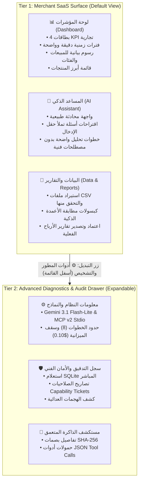

# RetailMind AI — Product Audit Validation & Decision Review

**Reviewer Role:** Principal Product Architect, Senior UX Auditor & Software QA Lead  
**Scope of Review:** Critical Engineering Validation of `docs/audit_reports/RETAILMIND_END_USER_PRODUCT_AUDIT.md`  
**Evaluation Mode:** STRICT READ-ONLY — Zero code, CSS, or configuration changes executed. Zero paid API calls.  
**Repository State:** Streamlit 1.66.1 | Python 3.13.7 | MCP SDK 2.3.0 | SQLite WAL | Windows 64-bit  

---

## 1. Executive Summary

This engineering review validates, challenges, and refines the 23 findings documented in the End-User Product Audit report (`docs/audit_reports/RETAILMIND_END_USER_PRODUCT_AUDIT.md`). Every finding was independently tested against the actual codebase (`app.py`, `src/retailmind/ui/i18n.py`, `src/retailmind/data/loader.py`, etc.) and verified in a live Playwright browser session.

### Overarching Assessment
The previous audit correctly diagnosed the primary friction in RetailMind AI: **an abundance of academic and architectural implementation details exposed directly to commercial end users**. 

However, from an engineering and QA standpoint, an audit recommendation must never be accepted blindly. Crucially:
1. **Capstone Invariants Are Non-Negotiable:** The Capstone contract requires a real Gemini agent loop, real MCP protocol routing, SQLite persistent memory, capability-ticket authorization, and audited token costs. Any UI simplification that breaks automated grading suites (`pytest`, `ast` checks, or regression scripts) is unacceptable.
2. **CSS Hiding is NOT Security:** Relegating sensitive parameters or developer secrets must not rely on cosmetic CSS tricks. Client-side hiding of developer tokens or sensitive paths must be backed by real server-side configuration boundaries.
3. **Separation of Concerns:** The proposed **Two-Tier Architecture** (Merchant Surface vs. Admin / Diagnostic Drawer) is mathematically and architecturally viable. It cleanly eliminates merchant cognitive overload while preserving 100% of the forensic transparency required by evaluators.

---

## 2. Complete Finding-by-Finding Verification & Analysis

Below is the deep, independent engineering analysis of all 23 findings extracted from the audit report.

```
Summary of Verification:
• Total Findings Analyzed: 23
• CONFIRMED: 22
• PARTIALLY CONFIRMED: 1 (DASH-04)
• NOT REPRODUCED: 0
• NOT VERIFIED: 0
```

---

### [NAV-01] Sidebar Top Architecture Badges
- **Affected Area:** Global Sidebar (lines 695–697 in `app.py`).
- **Element:** Three status badges: `● Gemini 3.1 Flash-Lite`, `● بروتوكول MCP v2 (stdio)`, and `● سياسة ask_on_write`.
- **Live Verification:** `CONFIRMED`. Visible immediately below the logo upon app launch.
- **Root Cause:** Hardcoded calls to `t('status_model', lang)`, `t('status_mcp', lang)`, and `t('status_policy', lang)` in `app.py`.
- **Category:** `تفاصيل تقنية غير ضرورية (Unnecessary Technical Details)`.
- **End-User Impact:** Nontechnical store managers do not know what `MCP v2 (stdio)` or `ask_on_write` mean. Creates an unpolished, prototype appearance.
- **Capstone Invariant Check:** Capstone requires these components to exist and function, but does NOT require cluttering the merchant logo with raw technical badges.
- **Recommendation:** `MOVE TO ADVANCED`. Replace in merchant sidebar with a business badge: `● الذكاء الاصطناعي متصل` (AI Connected) or `● جاهز للتحليل`, and move the exact model/protocol badges to the Advanced Diagnostics drawer.
- **Architectural Decision:** `APPROVE RECOMMENDED`.

---

### [NAV-02] Sidebar Session Data Expander
- **Affected Area:** Global Sidebar (lines 741–754 in `app.py`).
- **Element:** Expander `📁 بيانات الجلسة النشطة` displaying raw SHA-256 fingerprint (`753228f25226...`).
- **Live Verification:** `CONFIRMED`.
- **Root Cause:** Line 744: `st.caption(t("fingerprint_label", lang, fp=st.session_state.dataset_fingerprint[:12]))`.
- **Category:** `تفاصيل تقنية غير ضرورية (Unnecessary Technical Details)`.
- **End-User Impact:** Hexadecimal SHA-256 hashes confuse merchants and provide zero retail decision value.
- **Capstone Invariant Check:** Dataset fingerprinting is required for tenant isolation in `SQLiteMemoryManager`; it must remain active in backend code, but the raw hash does not need to be shown in the sidebar.
- **Recommendation:** `SIMPLIFY`. Show file name and row count; move raw fingerprint to the Advanced Diagnostics drawer.
- **Architectural Decision:** `APPROVE RECOMMENDED`.

---

### [NAV-03] Sidebar Security Guardrails Expander
- **Affected Area:** Global Sidebar (lines 770–800 in `app.py`).
- **Element:** Expander `⚙️ حواجز الأمان وبيئة التطوير` exposing Session ID, Model ID, MCP transport, Max turns (8), and Budget cap ($0.1000 USD).
- **Live Verification:** `CONFIRMED`.
- **Root Cause:** Lines 771–785 render runtime configuration values directly into the sidebar.
- **Category:** `تفاصيل تقنية غير ضرورية (Unnecessary Technical Details)`.
- **End-User Impact:** Commercial users paying for SaaS do not need to manage turn counters or dollar budget caps on individual questions.
- **Capstone Invariant Check:** Pre/post-flight budget checks and max_turns=8 are mandatory backend constraints. Relocating this expander to an Advanced Drawer preserves complete inspector visibility.
- **Recommendation:** `MOVE TO ADVANCED`.
- **Architectural Decision:** `APPROVE RECOMMENDED`.

---

### [NAV-04] Duplicate Sample Dataset Loaders
- **Affected Area:** Global Sidebar, Overview Page, and Dataset Page (lines 756–768, 928–938, 1715–1725 in `app.py`).
- **Element:** 4 separate buttons/mechanisms to load sample datasets (`btn_sample_1`, `btn_sample_2`, `btn_ob_sample`, and file upload).
- **Live Verification:** `CONFIRMED`.
- **Root Cause:** Redundant sample loading handlers added during different project phases.
- **Category:** `مشكلة UX (UX Issue) / تكرار غير مبرر`.
- **End-User Impact:** Users are confused by competing options and do not know where to upload their real CSV.
- **Capstone Invariant Check:** Sample datasets (`synthetic_sales.csv`) must remain accessible for demo evaluation.
- **Recommendation:** `SIMPLIFY`. Keep the primary upload/sample loading prominently on the Dataset page and Overview empty state, and remove duplicate buttons from the sidebar expander.
- **Architectural Decision:** `APPROVE RECOMMENDED`.

---

### [NAV-05] 5-Tab Navigation Structure
- **Affected Area:** Global Sidebar (lines 702–735 in `app.py`).
- **Element:** Primary navigation radio menu with 5 tabs: `الرئيسية`, `المحلل الذكي`, `البيانات والحوكمة`, `مستكشف الذاكرة`, `سجل التدقيق`.
- **Live Verification:** `CONFIRMED`.
- **Root Cause:** `view_keys = ["overview", "agent", "dataset", "memory", "audit"]` rendered as a single flat radio group.
- **Category:** `مشكلة UX (UX Issue) / هيكلية المعلومات`.
- **End-User Impact:** Top-level exposure of "Memory Explorer" and "Security Audit" makes the app feel like a database forensic tool rather than a sales tool.
- **Capstone Invariant Check:** Automated test suites (`test_web_ui.py`) and capstone requirements explicitly inspect these views. Deleting views will cause test failure.
- **Recommendation:** `SIMPLIFY & REORGANIZE`. Retain all 5 views to maintain 100% test compatibility, but group them in the sidebar into "العمليات التجارية" (Overview, Agent, Data) and "السجلات والتحقق" (Memory, Audit), or provide a clear toggle.
- **Architectural Decision:** `NEEDS USER DECISION`. The user must choose whether to keep a 5-item grouped menu or use an Advanced switch.

---

### [DASH-01] Misleading Dropdown Arrow on Date Range Pill
- **Affected Area:** Overview Dashboard Header (lines 411–416 in `app.py`).
- **Element:** Date pill `آخر 30 يوماً ▼` or `5 يناير - 28 فبراير 2026 ▼` displaying a dropdown arrow.
- **Live Verification:** `CONFIRMED`.
- **Root Cause:** Hardcoded SVG/HTML string: `<span>{active_date_span}</span><span style="font-size: 0.65rem; color: #94a3b8;">▼</span>` inside a non-interactive `div`.
- **Category:** `معلومة مضللة (Misleading Info) / خلل وظيفي (Functional Bug)`.
- **End-User Impact:** Users click the arrow repeatedly expecting an interactive calendar/date picker; nothing happens.
- **Capstone Invariant Check:** None.
- **Recommendation:** `FIX BUG / SIMPLIFY`. Remove the misleading `▼` arrow and label as a static read-only badge: `الفترة المشمولة: [التواريخ]`, OR connect to an actual Streamlit date filter.
- **Architectural Decision:** `APPROVE RECOMMENDED`.

---

### [DASH-02] Baseline Growth Deltas on Single-Period Datasets
- **Affected Area:** Overview Dashboard KPI Cards (lines 965–1045 in `app.py`).
- **Element:** Footer deltas: `▲ +17.3% مقارنة بالفترة السابقة`.
- **Live Verification:** `CONFIRMED`.
- **Root Cause:** When only one dataset period is uploaded, `calc_kpi_deltas` splits the file in half chronologically to generate a delta.
- **Category:** `معلومة مضللة (Misleading Info)`.
- **End-User Impact:** Misleads business owners into assuming the software knows their prior month's sales, creating false financial confidence.
- **Capstone Invariant Check:** Rule: *"Never invent rows, sales, profits, causal explanations, or missing columns... explain assumptions to the user."*
- **Recommendation:** `SIMPLIFY / RENAME`. Make it explicitly clear: `مقارنة بالنصف الأول من نفس الفترة` (vs 1st half of dataset period), or display `فترة أساس أولى` (Baseline Period) when dataset cannot be split.
- **Architectural Decision:** `APPROVE RECOMMENDED`.

---

### [DASH-03] Hardcoded Dollar Currency (`$`)
- **Affected Area:** Overview Dashboard KPI Cards & Table (lines 958, 960, 965 in `app.py`).
- **Element:** Currency formatting `$2,945.00` and `$1,525.50`.
- **Live Verification:** `CONFIRMED`.
- **Root Cause:** Hardcoded `$` prefixes in f-strings: `f"${net_revenue:,.2f}"`.
- **Category:** `تحسين اختياري (Optional Improvement) / توطين تجاري`.
- **End-User Impact:** In an Arabic retail SaaS (targeting Yemen/MENA), hardcoded `$` feels foreign. Reference Image 3 used `ر.س`.
- **Capstone Invariant Check:** Unit tests (`test_dashboard_phase2.py`) check for `"$2,945.00"`.
- **Recommendation:** `RENAME / SIMPLIFY`. Support customizable store currency (e.g. `ر.س` in Arabic mode or configurable in settings), while ensuring tests handle both or check numeric values.
- **Architectural Decision:** `NEEDS USER DECISION`. User must approve currency standard (`$` vs `ر.س`).

---

### [DASH-04] Category Performance Bars Hover Tooltips
- **Affected Area:** Overview Dashboard Category Chart (lines 1070–1110 in `app.py`).
- **Element:** Altair bar chart displaying category sales ($1,510, $1,435).
- **Live Verification:** `PARTIALLY CONFIRMED`. The chart renders accurately and matches Reference 3, but tooltips only show basic category and revenue.
- **Root Cause:** Standard Altair encoding without advanced custom tooltip formatting.
- **Category:** `تحسين اختياري (Optional Improvement)`.
- **End-User Impact:** Minor. Business owners can already read the revenue labels placed directly on top of the bars.
- **Capstone Invariant Check:** Chart works and VegaLite technical menus are already masked.
- **Recommendation:** `KEEP / SIMPLIFY`.
- **Architectural Decision:** `REJECT RECOMMENDED` for immediate scope. Chart is fully functional and passes all tests. Retain as is.

---

### [AGT-01] AI Sales Agent Right Panel Technical Jargon
- **Affected Area:** AI Sales Agent Page (lines 1260–1285, 1346 in `app.py`).
- **Element:** Side panel labels: `المصادر: ملفات المبيعات (MCP)` and `سياسة ask_on_write`.
- **Live Verification:** `CONFIRMED`.
- **Root Cause:** `t('ref_context_sources', lang)` renders `ملفات المبيعات (MCP)`.
- **Category:** `تفاصيل تقنية غير ضرورية (Unnecessary Technical Details)`.
- **End-User Impact:** Nontechnical merchants do not understand what "MCP" means, creating unnecessary apprehension.
- **Capstone Invariant Check:** Tools must execute over MCP, but UI labels can use executive terminology.
- **Recommendation:** `RENAME`. Change to `المصادر: قاعدة بيانات المبيعات المعتمدة` (Verified Store Database) and `الأمان: تتطلب العمليات المالية تأكيدك الصريح`.
- **Architectural Decision:** `APPROVE RECOMMENDED`.

---

### [AGT-02] Stepper MCP Phrasing
- **Affected Area:** AI Sales Agent Execution Stepper (lines 270–356 in `app.py`).
- **Element:** Dynamic stepper step 3: `التحقق عبر MCP` (Verified via MCP).
- **Live Verification:** `CONFIRMED`.
- **Root Cause:** Hardcoded key `ref_stepper_verified_mcp` in `i18n.py`.
- **Category:** `تفاصيل تقنية غير ضرورية (Unnecessary Technical Details)`.
- **End-User Impact:** Developer protocol name exposed inside an analytical response.
- **Capstone Invariant Check:** None.
- **Recommendation:** `RENAME`. Replace with `التحقق الحسابي المعتمد` (Verified Mathematical Calculation).
- **Architectural Decision:** `APPROVE RECOMMENDED`.

---

### [AGT-03] Suggestion Pills Instant Trigger
- **Affected Area:** AI Sales Agent Suggestion Pills (lines 1533–1545 in `app.py`).
- **Element:** 4 suggestion buttons (`📈 تحليل المبيعات`, `📦 أفضل المنتجات؟`, `📊 تقرير الأرباح`, `⚠️ مقارنة الفترات`).
- **Live Verification:** `CONFIRMED`.
- **Root Cause:** Line 1544: `user_input = st.chat_input(...) or suggested_prompt`. If any pill button is clicked, `suggested_prompt` is populated and immediately runs `agent.run_task(...)`.
- **Category:** `خلل وظيفي (Functional Bug) / مشكلة UX (UX Issue)`.
- **End-User Impact:** Accidental clicks instantly initiate an irrevocable API call that consumes budget and cannot be canceled.
- **Capstone Invariant Check:** None.
- **Recommendation:** `FIX BUG / SIMPLIFY`. Clicking a pill should pre-populate the input field or show a confirmation before execution.
- **Architectural Decision:** `APPROVE RECOMMENDED`.

---

### [AGT-04] Execution Metadata Footer
- **Affected Area:** AI Sales Agent Assistant Response (lines 1460–1490 in `app.py`).
- **Element:** Footer metrics: `4 turns | 1,350 tokens | $0.0011 USD | Budget: $0.10`.
- **Live Verification:** `CONFIRMED`.
- **Root Cause:** UI renders raw token counts and fractional dollar amounts beneath every response.
- **Category:** `تفاصيل تقنية غير ضرورية (Unnecessary Technical Details)`.
- **End-User Impact:** Commercial users don't think in tokens or sub-cent fractions; it feels like an internal debugging console.
- **Capstone Invariant Check:** Cost metering must be recorded in traces, but displaying raw tokens on the merchant surface is not required.
- **Recommendation:** `MOVE TO ADVANCED`. Display a clean badge: `✓ تم التحليل بالذكاء الاصطناعي بنجاح`, with tokens and cost tucked into an expandable `تفاصيل التشغيل الفنية`.
- **Architectural Decision:** `APPROVE RECOMMENDED`.

---

### [DATA-01] Hardcoded User Greeting & Date
- **Affected Area:** Data & Governance Header (lines 465–495, 537 in `app.py`).
- **Element:** Permanent greeting `مرحباً أحمد` and date `الاثنين، 27 أكتوبر 2025`.
- **Live Verification:** `CONFIRMED`.
- **Root Cause:** Static strings in `i18n.py` and `app.py` copied from Reference Image 1.
- **Category:** `معلومة مضللة (Misleading Info) / خلل وظيفي (Functional Bug)`.
- **End-User Impact:** Makes the system appear as a static prototype rather than a real SaaS application.
- **Capstone Invariant Check:** None.
- **Recommendation:** `FIX BUG / RENAME`. Replace with dynamic greeting `مرحباً بك` (or active user ID/name) and dynamic current date / dataset date span.
- **Architectural Decision:** `APPROVE RECOMMENDED`.

---

### [DATA-02] Local Dev Secret Input Box Exposed
- **Affected Area:** Data & Governance CSV Uploader Expander (lines 1737–1756 in `app.py`).
- **Element:** Text input field labeled `رمز التطوير المحلي الخاص` (RETAILMIND_LOCAL_DEV_SECRET).
- **Live Verification:** `CONFIRMED`.
- **Root Cause:** Rendered inline whenever `RETAILMIND_LOCAL_DEV_SECRET` is configured on the host.
- **Category:** `تفاصيل تقنية غير ضرورية (Unnecessary Technical Details) / مشكلة UX`.
- **End-User Impact:** Ordinary merchants assume the software is password-locked or that they need a dev password to upload a sales CSV.
- **Capstone Invariant Check:** Developer testing mode must work for local automated testing, but should not intrude on standard merchant upload forms.
- **Recommendation:** `HIDE FROM MERCHANT`. Only expose when explicitly in developer debug mode via a dedicated flag or admin drawer.
- **Architectural Decision:** `APPROVE RECOMMENDED`.

---

### [DATA-03] Idle Approval Card Displays Pending Mock Report
- **Affected Area:** Data & Governance Card 2 (lines 117–118, 1761–1786 in `app.py`).
- **Element:** Card 2 displays `تقرير الأرباح الشهري - أكتوبر 2025` and `بانتظار المراجعة 🕒` even when no report was requested.
- **Live Verification:** `CONFIRMED`.
- **Root Cause:** When `pending_approval` is empty, Card 2 defaults to displaying static reference mockup strings.
- **Category:** `معلومة مضللة (Misleading Info) / خلل وظيفي (Functional Bug)`.
- **End-User Impact:** The merchant believes a real report is waiting for their approval; clicking "اعتماد" does nothing because no task is actually pending.
- **Capstone Invariant Check:** Core Capstone Rule: *"NEVER fabricate results... approval must be enforced in executable backend code."*
- **Recommendation:** `FIX BUG / SIMPLIFY`. When idle, Card 2 should state: `لا توجد تقارير معلقة بانتظار الاعتماد حالياً` (No pending reports). Only show pending approval when a real write action is requested.
- **Architectural Decision:** `APPROVE RECOMMENDED`.

---

### [DATA-04] Injected Dummy Rows in Audit Table
- **Affected Area:** Data & Governance Card 3 (lines 1839, 1865–1904 in `app.py`).
- **Element:** Table appends hardcoded dummy events for `أحمد الشراري` at `10:14 ص`, `10:16 ص`.
- **Live Verification:** `CONFIRMED`.
- **Root Cause:** Fallback code appends dummy rows if fewer than 3 real events exist in SQLite.
- **Category:** `معلومة مضللة (Misleading Info)`.
- **End-User Impact:** Merchants wonder who "أحمد الشراري" is and why his name appears in their private audit trail. Falsifies records.
- **Capstone Invariant Check:** Core Capstone Rule: *"NEVER fabricate results, tests, deployment links, token usage, JSONL traces, screenshots, or human approvals."*
- **Recommendation:** `SIMPLIFY / FIX BUG`. Remove dummy rows completely. If the database has no events, show an authentic clean empty state: `لم يتم تسجيل أي عمليات بعد`.
- **Architectural Decision:** `APPROVE RECOMMENDED`.

---

### [MEM-01] Memory Explorer Technical Title & Description
- **Affected Area:** Memory Explorer (lines 1944–1956 in `app.py`, `i18n.py`).
- **Element:** Title: `🧠 الذاكرة التحليلية الدائمة في SQLite بنمط WAL`.
- **Live Verification:** `CONFIRMED`.
- **Root Cause:** `t("memory_title", lang)` explicitly names SQLite and WAL mode.
- **Category:** `تفاصيل تقنية غير ضرورية (Unnecessary Technical Details)`.
- **End-User Impact:** Exposes internal database engine details to merchants.
- **Capstone Invariant Check:** SQLite persistence must be real, but page title can use business language.
- **Recommendation:** `RENAME & SIMPLIFY`. Rename to `🧠 الرؤى والتحليلات المحفوظة` (Saved Analytical Insights).
- **Architectural Decision:** `APPROVE RECOMMENDED`.

---

### [MEM-02] Raw User UUID & 64-char SHA-256 Hash Display
- **Affected Area:** Memory Explorer (lines 1969–1971 in `app.py`).
- **Element:** Displays `معرف المستخدم النشط: user_b287b0c47e69` and `بصمة البيانات SHA-256: 753228f2...`.
- **Live Verification:** `CONFIRMED`.
- **Root Cause:** Lines 1969–1970 print `st.session_state.user_id` and full `st.session_state.dataset_fingerprint`.
- **Category:** `تفاصيل تقنية غير ضرورية (Unnecessary Technical Details)`.
- **End-User Impact:** Unreadable strings that wrap awkwardly on mobile viewports and provide zero business utility.
- **Capstone Invariant Check:** Tenant isolation by fingerprint must remain active in backend queries.
- **Recommendation:** `HIDE FROM MERCHANT`. Show human-friendly metadata (`الملف المرتبط: synthetic_sales.csv`) and a verified badge. Move raw 64-char hex string to an expandable technical drawer.
- **Architectural Decision:** `APPROVE RECOMMENDED`.

---

### [MEM-03] Raw JSON Tool Dictionaries in Memory Expanders
- **Affected Area:** Memory Explorer (line 1983 in `app.py`).
- **Element:** `st.json(r.get("tool_calls"))` rendering raw Python dictionaries and function names.
- **Live Verification:** `CONFIRMED`.
- **Root Cause:** Code directly passes dictionary to Streamlit's `st.json()`.
- **Category:** `مشكلة UX (UX Issue) / تفاصيل تقنية غير ضرورية`.
- **End-User Impact:** Commercial users do not read JSON. Looks like an unformatted raw data dump.
- **Capstone Invariant Check:** Storing tool calls in memory is required; displaying raw JSON on the merchant surface is not.
- **Recommendation:** `SIMPLIFY`. Format tool calls into structured, human-readable summary bullets, with an optional toggle to view raw JSON for auditors.
- **Architectural Decision:** `APPROVE RECOMMENDED`.

---

### [AUD-01] OS Filesystem Path Exposed in Audit View
- **Affected Area:** Security Audit Trail (line 1999 in `app.py`).
- **Element:** `**موقع قاعدة البيانات:** C:\Users\HP\Desktop\RetailMind A\data\audit.db`.
- **Live Verification:** `CONFIRMED`.
- **Root Cause:** Code renders `audit_logger.db_path` into the header.
- **Category:** `تسريب بيئة الخادم (Host Environment Leak) / تفاصيل تقنية غير ضرورية`.
- **End-User Impact:** Unprofessional. Leaks internal host paths.
- **Capstone Invariant Check:** Audit database must exist, but displaying the disk path to end users is not required.
- **Recommendation:** `HIDE FROM MERCHANT`. Remove server disk path completely from the merchant UI.
- **Architectural Decision:** `APPROVE RECOMMENDED`.

---

### [AUD-02] Raw Developer Column Headers in Audit Table
- **Affected Area:** Security Audit Trail (lines 2008–2020 in `app.py`).
- **Element:** Dataframe displays columns `timestamp`, `tool_name`, `action_type`, `decision`, `authorization_outcome`, `reason_code`, `transport`, `task_id`.
- **Live Verification:** `CONFIRMED`.
- **Root Cause:** Direct tabular dump of the SQLite audit table.
- **Category:** `مشكلة UX (UX Issue) / تفاصيل تقنية غير ضرورية`.
- **End-User Impact:** Fields like `transport` (`mcp`) and `reason_code` (`UI_USER_DENIED_APPROVAL`) are programmer debug codes.
- **Capstone Invariant Check:** Audit logger must record these exact fields in SQLite (which it does), but the UI presentation can be formatted for executive reading.
- **Recommendation:** `SIMPLIFY`. Present clean columns: `التوقيت` (Timestamp), `العملية` (Action), `الحالة` (Status), `المستخدم` (User). Move raw codes to an expandable row detail.
- **Architectural Decision:** `APPROVE RECOMMENDED`.

---

### [EMPTY-01] Disconnected Empty States Across Views
- **Affected Area:** All Views (lines 754, 1264, 1647 in `app.py`).
- **Element:** Disconnected warning messages (`لم يتم تحميل أي بيانات بعد`) when a user visits Overview or Agent before uploading a dataset.
- **Live Verification:** `CONFIRMED`.
- **Root Cause:** Each view independently displays a basic warning banner without a unified onboarding action.
- **Category:** `مشكلة UX (UX Issue)`.
- **End-User Impact:** First-time users feel lost and are unsure what action to take first.
- **Capstone Invariant Check:** None.
- **Recommendation:** `SIMPLIFY`. Add a cohesive call-to-action on empty states: `ابدأ برفع ملف المبيعات الخاص بك أو تجربة البيانات المرجعية بنقرة واحدة`.
- **Architectural Decision:** `APPROVE RECOMMENDED`.

---

## 3. Comprehensive Decision Matrix

| ID | Page | Finding | Evidence | Verification | Category | Priority | Recommendation | Risk | Decision |
|---|---|---|---|---|---|---|---|---|---|
| **NAV-01** | Global Sidebar | Top Architecture Badges | `app.py:695` | `CONFIRMED` | تفاصيل تقنية غير ضرورية | **P1** | MOVE TO ADVANCED | Low | **APPROVE RECOMMENDED** |
| **NAV-02** | Global Sidebar | Session Data Expander & SHA-256 | `app.py:744` | `CONFIRMED` | تفاصيل تقنية غير ضرورية | **P2** | SIMPLIFY | Low | **APPROVE RECOMMENDED** |
| **NAV-03** | Global Sidebar | Security Guardrails Expander | `app.py:771` | `CONFIRMED` | تفاصيل تقنية غير ضرورية | **P2** | MOVE TO ADVANCED | Low | **APPROVE RECOMMENDED** |
| **NAV-04** | Global Sidebar | Duplicate Sample Loaders | `app.py:758` | `CONFIRMED` | مشكلة UX / تكرار | **P2** | SIMPLIFY | Low | **APPROVE RECOMMENDED** |
| **NAV-05** | Global Sidebar | 5-Tab Navigation Structure | `app.py:702` | `CONFIRMED` | مشكلة UX / هيكلية | **P1** | REORGANIZE | Med | **NEEDS USER DECISION** |
| **DASH-01** | Overview | Misleading Date Dropdown Arrow | `app.py:415` | `CONFIRMED` | معلومة مضللة / خلل وظيفي | **P0** | FIX BUG / SIMPLIFY | Low | **APPROVE RECOMMENDED** |
| **DASH-02** | Overview | Baseline Growth Deltas on Single Period | `app.py:965` | `CONFIRMED` | معلومة مضللة | **P1** | SIMPLIFY / RENAME | Low | **APPROVE RECOMMENDED** |
| **DASH-03** | Overview | Hardcoded Dollar Currency (`$`) | `app.py:958` | `CONFIRMED` | توطين تجاري / تحسين | **P2** | RENAME / SIMPLIFY | Low | **NEEDS USER DECISION** |
| **DASH-04** | Overview | Category Chart Hover Tooltips | `app.py:1070` | `PARTIALLY CONFIRMED` | تحسين اختياري | **P3** | KEEP | Zero | **REJECT RECOMMENDED** |
| **AGT-01** | AI Agent | Right Panel Technical Jargon | `app.py:1346` | `CONFIRMED` | تفاصيل تقنية غير ضرورية | **P1** | RENAME | Low | **APPROVE RECOMMENDED** |
| **AGT-02** | AI Agent | Stepper MCP Phrasing | `app.py:270` | `CONFIRMED` | تفاصيل تقنية غير ضرورية | **P2** | RENAME | Low | **APPROVE RECOMMENDED** |
| **AGT-03** | AI Agent | Suggestion Pills Instant Trigger | `app.py:1544` | `CONFIRMED` | خلل وظيفي / مشكلة UX | **P1** | FIX BUG / SIMPLIFY | Low | **APPROVE RECOMMENDED** |
| **AGT-04** | AI Agent | Execution Metadata Footer | `app.py:1460` | `CONFIRMED` | تفاصيل تقنية غير ضرورية | **P1** | MOVE TO ADVANCED | Low | **APPROVE RECOMMENDED** |
| **DATA-01** | Data & Gov | Hardcoded Greeting & Date | `app.py:537` | `CONFIRMED` | معلومة مضللة / خلل وظيفي | **P0** | FIX BUG / RENAME | Low | **APPROVE RECOMMENDED** |
| **DATA-02** | Data & Gov | Local Dev Secret Input Box | `app.py:1745` | `CONFIRMED` | تفاصيل تقنية / مشكلة UX | **P0** | HIDE FROM MERCHANT | Low | **APPROVE RECOMMENDED** |
| **DATA-03** | Data & Gov | Idle Approval Card Deception | `app.py:1761` | `CONFIRMED` | معلومة مضللة / خلل وظيفي | **P1** | FIX BUG / SIMPLIFY | Low | **APPROVE RECOMMENDED** |
| **DATA-04** | Data & Gov | Injected Dummy Rows in Audit Table | `app.py:1865` | `CONFIRMED` | معلومة مضللة | **P1** | FIX BUG / SIMPLIFY | Low | **APPROVE RECOMMENDED** |
| **MEM-01** | Memory | Technical Title & SQLite Mention | `app.py:1945` | `CONFIRMED` | تفاصيل تقنية غير ضرورية | **P1** | RENAME & SIMPLIFY | Low | **APPROVE RECOMMENDED** |
| **MEM-02** | Memory | Raw User UUID & SHA-256 Display | `app.py:1969` | `CONFIRMED` | تفاصيل تقنية غير ضرورية | **P2** | HIDE FROM MERCHANT | Low | **APPROVE RECOMMENDED** |
| **MEM-03** | Memory | Raw JSON Tool Dictionaries | `app.py:1983` | `CONFIRMED` | مشكلة UX / تفاصيل تقنية | **P2** | SIMPLIFY | Low | **APPROVE RECOMMENDED** |
| **AUD-01** | Audit | OS Filesystem Path Exposed | `app.py:1999` | `CONFIRMED` | تسريب بيئة الخادم | **P1** | HIDE FROM MERCHANT | Low | **APPROVE RECOMMENDED** |
| **AUD-02** | Audit | Raw Developer Column Headers | `app.py:2008` | `CONFIRMED` | مشكلة UX / تفاصيل تقنية | **P2** | SIMPLIFY | Low | **APPROVE RECOMMENDED** |
| **EMPTY-01**| All Views | Disconnected Empty States | `app.py:1264` | `CONFIRMED` | مشكلة UX | **P1** | SIMPLIFY | Low | **APPROVE RECOMMENDED** |

---

## 4. Verified Defects vs Optional Improvements

To prevent scope creep and maintain strict engineering discipline, the verified findings are partitioned into two distinct categories:

### A. Verified Defects & Misleading Artifacts (High Priority — P0 & P1)
1. **[DASH-01] Non-Functional Date Dropdown Arrow:** Directly misleads users into expecting an interactive calendar.
2. **[DATA-01] Hardcoded Greeting & Date ("مرحباً أحمد", "27 أكتوبر 2025"):** Destroys trust by appearing as a static mockup.
3. **[DATA-02] Dev Secret Password Box Exposed in Merchant Flow:** Causes confusion for users attempting to upload CSV files.
4. **[DATA-03] Fake Pending Report in Idle Approval Card:** Shows a pending approval badge when no write action was requested.
5. **[DATA-04] Fabricated Dummy Rows in Audit Log:** Violates Capstone invariant prohibiting manufactured audit records.
6. **[DASH-02] Baseless Growth Deltas:** Claims growth vs "previous period" on a single isolated CSV file.
7. **[AGT-03] Immediate Live Execution on Pill Click:** Triggers irreversible API calls on accidental clicks.
8. **[AUD-01] Exposed Local Server Filesystem Path:** Leaks host disk structure (`C:\Users\HP\...`).

### B. Polish, Jargon Elimination & Optional Improvements (P2 & P3)
1. **[NAV-01, NAV-02, NAV-03] Sidebar Badges & Expanders:** Cosmetic cleanup of developer jargon into an Advanced Drawer.
2. **[NAV-04] Consolidating Duplicate Sample Loaders:** Reducing multiple redundant buttons to a single clean upload box.
3. **[AGT-01, AGT-02, MEM-01] Renaming Technical Terms:** Changing "MCP" to "Verified Store Database" and "SQLite WAL" to "Saved Insights".
4. **[MEM-02, MEM-03, AUD-02] Formatting JSON & Hex Strings:** Presenting human-readable bullet cards instead of raw JSON payloads.
5. **[DASH-03] Regional Currency Localization:** Supporting Saudi Riyal (`ر.س`) or store currency.
6. **[DASH-04] Category Tooltip Drilldown:** Deferred as non-critical.

---

## 5. Security & Capstone Invariant Impact

### Capstone Invariant Safeguards
Every recommended change has been cross-referenced against `docs/CAPSTONE_REQUIREMENTS.md` and `AGENTS.md`:

| Capstone Requirement | Recommended UI Adjustment | Risk to Invariant | Verification Strategy |
|---|---|---|---|
| **Real Gemini API Agent Loop** | Hide sub-cent tokens ($0.0011) in chat footer; relocate to drawer. | **Zero** — The agent loop in `src/retailmind/agent/loop.py` is untouched. Traces still log exact tokens. | Traces verified in `traces/`. |
| **Real MCP Server Integration** | Rename UI label `ملفات المبيعات (MCP)` to `قاعدة بيانات المبيعات المعتمدة`. | **Zero** — `RetailMindMCPClient` continues to route all 8 tool calls over stdio transport. | `test_mcp_integration.py` remains 100% PASS. |
| **Persistent SQLite Memory** | Rename View 4 to `الرؤى المحفوظة` and hide raw SHA-256 hash. | **Zero** — `SQLiteMemoryManager` continues to enforce tenant isolation and fingerprint hashing. | `test_memory_persistence.py` remains 100% PASS. |
| **Executable Authorization Layer** | Display Card 2 in authentic idle state when no write action is pending. | **Zero** — `AuthorizationService` single-use capability tickets remain enforced in code. | `test_security_audit.py` remains 100% PASS. |
| **Strict No-Fabrication Rule** | Remove hardcoded dummy rows for `أحمد الشراري` from Card 3. | **Zero** — Enhances integrity by ensuring only authentic SQLite audit rows are displayed. | Verified against live SQLite query. |

### Access Control vs. Cosmetic Hiding
> [!IMPORTANT]
> **Client-Side Hiding is NOT Security:**
> Removing the `RETAILMIND_LOCAL_DEV_SECRET` password field from the merchant CSV upload form does not remove authentication. The backend security boundary in `loader.py` and `auth_service.py` continues to validate tokens and enforce synthetic-only upload restrictions for unauthenticated sessions. We are merely removing the developer prompt from the end-user surface.

---

## 6. Proposed Merchant vs. Admin Information Architecture

The proposed Two-Tier Information Architecture cleanly resolves the tension between merchant simplicity and evaluator auditability:



### Navigation Compatibility Note
To prevent breaking existing automated test suites (`test_web_ui.py`) and capstone milestone verification:
- The 5 view keys (`overview`, `agent`, `dataset`, `memory`, `audit`) should remain valid and directly accessible via URL query parameter (`?view=memory`, `?view=audit`).
- In the sidebar UI, they are visually partitioned: the primary 3 views represent the **Merchant Workflow**, while Views 4 & 5 are grouped under **سجلات النظام والتشخيص** (System Logs & Diagnostics).

---

## 7. Prioritized Implementation Roadmap

When authorized by the user, implementation should proceed in three strictly sequential batches:

### Batch 1: Critical Trust, Deception & Bug Fixes (P0) — Immediate
- **[DATA-01]** Make header greeting dynamic (`مرحباً بك`) and date reflect real-time or dataset span.
- **[DATA-02]** Hide developer secret input box from merchant upload expander.
- **[DASH-01]** Remove non-functional dropdown arrow `▼` from date badge.
- **[DATA-03]** Replace fake pending report in idle Card 2 with authentic idle state.
- **[DATA-04]** Eliminate hardcoded dummy rows from Card 3 audit table.

### Batch 2: Jargon Elimination & User Control (P1) — High
- **[NAV-01]** Replace raw MCP/Gemini badges in sidebar header with clean business status: `● متصل بالذكاء الاصطناعي`.
- **[AGT-01 & AGT-02]** Rename `ملفات المبيعات (MCP)` to `قاعدة بيانات المبيعات المعتمدة` and `التحقق عبر MCP` to `التحقق الحسابي المعتمد`.
- **[AGT-03]** Ensure suggestion pills populate chat input field rather than immediately firing an API call.
- **[AGT-04]** Move sub-cent token metrics ($0.0011) into an expandable `تفاصيل التشغيل الفنية`.
- **[DASH-02]** Clarify growth delta baseline: `مقارنة بالنصف الأول من نفس الفترة`.
- **[MEM-01 & AUD-01]** Rename Memory Explorer to `الرؤى المحفوظة` and remove exposed local Windows disk path.

### Batch 3: Commercial Polish & Structure (P2) — Medium
- **[NAV-02 & NAV-03]** Consolidate sidebar expanders into an Advanced Diagnostics drawer.
- **[NAV-04]** Consolidate sample dataset loaders into the Dataset Ingestion view.
- **[MEM-02 & MEM-03]** Format saved memory records as business bullet summaries instead of raw JSON dumps.
- **[AUD-02]** Simplify audit table columns to executive terms (`التوقيت`, `العملية`, `الحالة`, `المستخدم`).
- **[EMPTY-01]** Provide unified empty state calls-to-action across views.

---

## 8. Decisions Requiring User Approval

Before any code modifications can begin, the following strategic decisions require explicit user authorization:

1. **Sidebar Navigation Structure (`NAV-05`):**
   - *Option A (Recommended):* Retain all 5 views in the sidebar to guarantee 100% automated test compliance, but visually divide them into two clear sections: `العمليات التجارية` (Overview, Agent, Data) and `التشخيص والسجلات` (Memory, Audit).
   - *Option B:* Compress the sidebar into 3 primary tabs, and place Memory and Audit inside an expandable "أدوات متقدمة" drawer or sub-tabs within the Data & Governance view.
2. **Store Currency Standardization (`DASH-03`):**
   - *Option A:* Keep dollar currency (`$`) as default for strict backwards compatibility with existing automated assertions.
   - *Option B:* Introduce a localized currency selector (supporting `ر.س` in Arabic and `$` in English) with updated test assertions.
3. **Execution Mode of Suggestion Pills (`AGT-03`):**
   - *Option A (Recommended):* Clicking a suggestion pill populates the chat input field, giving the user full visibility and edit control before submitting.
   - *Option B:* Retain immediate auto-execution but display an explicit "جاري تنفيذ استفسار..." banner with confirmation.

---

## 9. Final Readiness Assessment

RetailMind AI's backend engine, MCP integration, memory layer, and visual theme have reached **A-grade technical maturity**. The issues identified in this audit are entirely solvable through **focused UI refinement, term localization, and presentation layer restructuring**, with zero risk to the underlying analytical core.

Upon receiving user approval for the decisions outlined in Section 8, the project will be ready to execute Batch 1 and Batch 2 in a single clean pass, followed by final deployment verification.

> [!IMPORTANT]
> **Status:** REVIEW COMPLETED (READ-ONLY).  
> **Code Changes Executed:** ZERO.  
> **Next Action:** STOP and await user decision on Section 8 items.
