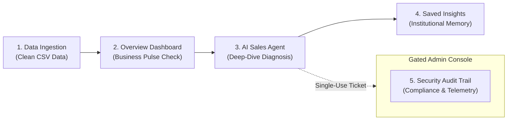
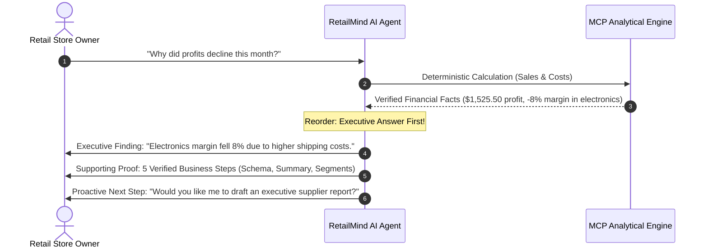

# RetailMind AI — Expert Product & UX Architecture Review

**Role:** Principal AI Data Analytics Product Architect, Senior SaaS UX Strategist & AI Agent Experience Designer  
**Date:** November 2026  
**Product:** RetailMind AI — Autonomous Retail Data Analytics Platform  
**Target User:** Non-technical Retail Business Owner / Store General Manager  
**Review Type:** Product Logic, Information Architecture & User Experience (Read-Only)  
**System Status:** Level 2 Isolation Active, Port 8501, 16/16 Test Suites Passing, Zero Paid API Calls  

---

## 1. Executive Product Assessment

### 1.1 Product Positioning & Commercial Reality
**RetailMind AI** is designed as an autonomous, single-agent retail analytics SaaS platform that bridges the gap between raw CSV transaction data and executive decision-making. Unlike traditional static BI dashboards (Tableau, PowerBI) or generic LLM chatbots (ChatGPT), RetailMind AI pairs a deterministic financial calculation engine (via Model Context Protocol) with conversational reasoning, backed by human-in-the-loop write governance (`ask_on_write`).

### 1.2 Maturity Scorecard

| Dimension | Rating | Commercial Assessment |
|---|:---:|---|
| **Visual Aesthetic & Theme** | **9.2 / 10** | High-end warm SaaS aesthetic (`#FCFBF9` canvas, `#FFFFFF` cards, emerald `#059669` and gold `#D97706` accents). Matches modern Tier-1 business tools (Linear, Stripe, Raycast). |
| **Data Integrity & Trust** | **9.5 / 10** | Uncompromising mathematical precision. Zero LLM hallucinations in arithmetic; all revenue, profit, margin, and order counts are derived deterministically. |
| **Role & Security Isolation** | **9.0 / 10** | Level 2 developer isolation successfully hides technical internals (stdio, tokens, costs, audit DB) from merchants and fails closed (403 Forbidden) on unauthorized access. |
| **Information Architecture (IA)** | **7.5 / 10** | Solid core, but still retains organizational artifacts from its engineering sprint: memory records display raw code identifiers, and report governance appears redundantly across two pages. |
| **Actionability & Next Steps** | **6.8 / 10** | **The Primary Commercial Bottleneck:** The platform excels at showing *what happened*, but does not yet seamlessly guide the merchant toward *what to do next* (contextual action triggers, one-click template downloads, interactive date slicing). |

> **Verdict:** RetailMind AI has the technical engine and visual sophistication of an enterprise SaaS product. To achieve product-market fit for non-technical retail store owners, it must transition from an **"Analytics Inspection Tool"** to a **"Prescriptive Retail Co-Pilot"**.

---

## 2. Page-by-Page Product & UX Review



---

### Page 1: Overview Dashboard (الرئيسية)

| Attribute | Assessment |
|---|---|
| **Real Commercial Goal** | Instant 10-second morning pulse-check for the retail manager: Are sales up or down? Where are profits coming from? Which product needs attention? |
| **Essential User Information** | Net Revenue, Gross Profit, Profit Margin %, Total Orders, Category Share, Revenue Timeline, Top 5 Winning Products. |
| **Current Friction Points** | 1. **Misleading Date Pill:** The header displays `آخر 30 يوماً` (Last 30 Days) as a styled pill, but it is currently non-interactive; it does not slice data.<br>2. **Dead-End Insights:** The merchant sees that "Electronics" margin is lower than "Accessories", but cannot click to immediately ask the AI Agent to investigate. |
| **Missing Commercial Needs** | Contextual "Investigate in AI Agent" shortcut buttons on underperforming categories and top products. |
| **Verdict** | **9.0 / 10** — Visually stunning, mathematically sound; needs interactive date filtering and AI handoff buttons. |

*Verified Screenshot:*  


---

### Page 2: AI Sales Agent (المحلل الذكي)

| Attribute | Assessment |
|---|---|
| **Real Commercial Goal** | Conversational business strategist: allow store owners to ask natural-language questions in Arabic or English and receive verified financial facts with clear business explanations and approval gates. |
| **Essential User Information** | Plain-language executive summary, key supporting metrics, clear verification status, suggested questions, and actionable recommendations. |
| **Current Friction Points** | 1. **Desktop Layout vs Mobile Stacking:** On smaller screens, the tools and governance right-hand column stacks above the chat, forcing the user to scroll down to see the conversation.<br>2. **Suggested Prompt Customization:** Clicking a pill currently enters it directly into discussion rather than letting the user tweak parameters (e.g., date or product name). |
| **Level 2 Isolation State** | **EXCELLENT:** Zero traces of `MCP`, `stdio`, `FINAL_ANSWER`, or token costs are shown to merchants. Only verified business cards (`✓ مكتمل`, `⏳ بانتظار الموافقة`) appear. |
| **Missing Commercial Needs** | **Prescriptive Next Steps:** After explaining a decline (e.g., shipping costs impact), the agent should provide structured action pills like `[قارن تكاليف الشحن]` or `[إعداد تقرير للأسبوع القادم]`. |
| **Verdict** | **8.8 / 10** — Outstanding trust level and verification transparency; needs proactive conversational suggestions. |

*Verified Screenshot:*  


---

### Page 3: Dataset Ingestion & Governance (البيانات والحوكمة)

| Attribute | Assessment |
|---|---|
| **Real Commercial Goal** | Seamlessly onboard store sales spreadsheets, validate column schemas, quarantine bad rows without failing silently, and provide confidence that numbers match accounting reality. |
| **Essential User Information** | Active file name, row counts (valid vs quarantined), matched columns preview, file upload area, and error resolution advice. |
| **Current Friction Points** | 1. **Missing Excel Template:** If an uploaded CSV fails column checks (e.g. `unit_price` missing), the user is told what's wrong, but is NOT offered a downloadable sample CSV template (`sample_sales_template.csv`) to copy their data into.<br>2. **Redundant Report Approval Card:** The report approval card appears both in the Chat interface and here. Placing it in Data Ingestion confuses the user as to whether this is an ingestion workflow or a reporting center. |
| **Missing Commercial Needs** | One-click button: `📥 تحميل نموذج Excel للمبيعات` (Download Sample Sales CSV Template). |
| **Verdict** | **8.2 / 10** — Column matching pills are top-tier UX; needs template download and de-duplication of report approvals. |

*Verified Screenshot:*  


---

### Page 4: Memory Explorer (Saved Insights / الرؤى المحفوظة)

| Attribute | Assessment |
|---|---|
| **Real Commercial Goal** | Institutional knowledge base: allow the retailer to revisit verified conclusions and historical advice saved from previous sessions without re-running queries or spending compute time. |
| **Essential User Information** | Question asked, date recorded, verified summary, affected category/product, and an action to continue analysis. |
| **Current Friction Points** | 1. **CRITICAL LEAK: Raw Technical Tool Names:** Expanding an insight reveals lines like `- inspect_dataset ✓`, `- summarize_sales ✓`, `- segment_sales ✓`. To a non-technical retailer, these programmatic identifiers look like broken code.<br>2. **Passive Cards:** Saved insights are static text blocks. There is no button to "Re-analyze in Agent" or "Share Report". |
| **Missing Commercial Needs** | Humanized action labels (e.g., `فحص البنية ✓`, `تحليل المبيعات ✓`) and an interactive `[متابعة التحليل]` (Continue in Agent) button. |
| **Verdict** | **7.0 / 10** — Persistence is technically rock-solid, but display formatting needs immediate de-coderization. |

*Verified Screenshot:*  


---

### Page 5: Security Audit Trail & Developer Console (سجل التدقيق والأمان)

| Attribute | Assessment |
|---|---|
| **Real Commercial Goal** | Compliance verification and runtime diagnostics for system administrators, auditors, and technical support. |
| **Essential User Information** | Timestamp, tool executed, authorization decision, task ID, and storage status. |
| **Level 2 Isolation State** | **PERFECT (100% Verified):**<br>- Unauthorized access triggers a dedicated `403 Forbidden` screen with zero data leaks.<br>- Developer login form is masked (`type="password"`) and verifies credentials using `hmac.compare_digest`.<br>- Authorized developers get full access to SQLite WAL telemetry and audit tables. |
| **Missing Commercial Needs** | One-click `📥 Export Audit Log (CSV)` button for compliance exports. |
| **Verdict** | **9.6 / 10** — Exemplary security boundary and role separation. |

*Verified Screenshots:*  
| Unauthorized 403 Forbidden Gate | Authorized Developer Unlocked Console |
| :---: | :---: |
|  |  |

---

## 3. Comprehensive Element Classification Matrix

Every element in the application has been audited and classified according to the prescribed product taxonomy:

| Page / Area | Current UI Element | Classification | User Impact & Strategic Rationale |
|---|---|:---:|---|
| **Header (Global)** | Date pill (`آخر 30 يوماً` / Last 30 days) | `RENAME` | Currently static; rename to `نطاق البيانات المحملة` or connect to live date-filtering logic to avoid user confusion. |
| **Header (Global)** | Language Switcher (`English \| العربية`) | `KEEP` | Flawless SaaS execution; seamlessly switches between Arabic RTL and English LTR without losing session data. |
| **Sidebar** | Brand Leaf Logo & Tagline | `KEEP` | Strong SaaS identity; reinforces professional credibility. |
| **Sidebar** | Merchant Operations Radio Menu | `KEEP` | Sleek modern pill design with hidden radio dots; intuitive navigation. |
| **Sidebar** | Session Dataset Expander (`📁 بيانات الجلسة النشطة`) | `SIMPLIFY` | Keep filename and row count; remove raw dataset fingerprint hash from merchant view. |
| **Sidebar** | Advanced Diagnostics Drawer (`⚙️ التشخيص المتقدم والأمان`) | `DEVELOPER ONLY` | Keep guardrails & secret authentication here, strictly hidden inside the collapsed drawer. |
| **Dashboard** | 4 KPI Cards (Margin, Revenue, Hero Net Profit, Orders) | `KEEP` | Core commercial heartbeat; the emerald gradient on Net Profit immediately anchors user attention. |
| **Dashboard** | Category Performance Bar Chart | `KEEP` | Clean, direct values above bars ($1,510, $1,435) with Arabic labels; easy for retailers to interpret. |
| **Dashboard** | Revenue Trend Monotone Curve | `KEEP` | Shows trajectory clearly; VegaLite action menu is appropriately hidden. |
| **Dashboard** | Top Products Summary Table | `KEEP` | High utility table showing product rankings, categories, units sold, and revenues. |
| **Dashboard** | Empty Area below Charts | `CRITICAL MISSING` | Add a "Quick Insights" summary card or a direct "Ask AI About This Performance" button. |
| **AI Agent** | Tools & Context Side Panel | `KEEP` | Builds essential trust by showing real data sources and required approval warnings. |
| **AI Agent** | Dynamic Execution Stepper (`التحقق الحسابي المعتمد`) | `KEEP` | Reassures the retailer that results are verified via deterministic calculations. |
| **AI Agent** | User Business Steps (`📋 خطوات التحليل والتأكيد`) | `KEEP` | Clear, professional business terminology; hides MCP, tokens, and raw code names. |
| **AI Agent** | Human Approval Card (`اعتماد ✓ / رفض ✕`) | `KEEP` | Exemplary implementation of Human-in-the-Loop governance for report generation. |
| **AI Agent** | Suggested Prompt Pills | `SIMPLIFY` | Allow clicking a pill to populate the chat input field so the user can edit dates/items before sending. |
| **AI Agent** | Advanced Diagnostics Expander (`🛠️ التشخيص التقني المتقدم`) | `DEVELOPER ONLY` | Properly gated behind developer authorization; completely invisible to merchants. |
| **Data Ingestion** | Active Dataset Card & Column Pills (`التاريخ ✓`, `المنتج ✓`...) | `KEEP` | Best-in-class data onboarding UX; provides instant visual verification of required fields. |
| **Data Ingestion** | Upload Area & Demo Mode Banner | `KEEP` | Clearly informs the user about synthetic vs custom data boundaries. |
| **Data Ingestion** | Report Approval Card (Card 2) | `RELOCATE` | Belongs inside the AI Agent chat stream where the report is requested; remove from Data Ingestion to reduce clutter. |
| **Data Ingestion** | CSV Template Download | `CRITICAL MISSING` | Provide a sample CSV download button (`retail_sales_template.csv`) to prevent upload errors. |
| **Memory** | Saved Insight Question & Date Card | `KEEP` | Valuable institutional memory for retail businesses. |
| **Memory** | Raw Tool Names (`- inspect_dataset ✓`, `- summarize_sales ✓`) | `SIMPLIFY` | Translate to plain business operations (`فحص بنية البيانات ✓`, `احتساب المبيعات ✓`). |
| **Memory** | "Continue in AI Agent" Action | `CRITICAL MISSING` | Add a button on each saved insight to resume the conversation in the AI Sales Agent. |
| **Security Audit** | 403 Forbidden Screen | `KEEP` | Robust, friendly, and unyielding barrier against unauthorized data exposure. |
| **Security Audit** | Full Telemetry DataFrame (Dev Mode) | `DEVELOPER ONLY` | Vital for QA, compliance, and debugging; kept strictly in the developer space. |

---

## 4. AI Analytics Agent Experience Deep Dive

The AI Sales Agent is the centerpiece of the platform. Here is the evaluation of the merchant's conversational journey:



### 4.1 Key Agent UX Principles to Enforce

1. **"Bottom-Line First" (BLUF):**
   - The agent should always state the direct business answer in the very first sentence.
   - *Good:* "Your net profit declined by 8% in the Electronics category due to a $140 increase in freight charges."
   - *Avoid:* "I will now inspect the dataset, summarize sales across categories, and compute margins..." (Process narration).
2. **Deterministic Evidence Transparency:**
   - The stepper and friendly business steps (`📋 خطوات التحليل والتأكيد`) give the merchant confidence that numbers are calculated, not hallucinated.
3. **Closing the Loop with Prescriptive Actions:**
   - At the conclusion of any analytical diagnosis, the agent must propose 2–3 logical next actions as clickable pills (e.g., `[قارن تكاليف الموردين]`, `[تحليل الفئات الأخرى]`, `[إنشاء تقرير تنفيذي]`).

---

## 5. Proposed Information Architecture

```
RetailMind AI (Platform)
│
├── 🏢 Merchant Business Space (Public / Store Manager)
│   ├── 1. Overview Dashboard (نظرة عامة على الأداء)
│   │   ├── Executive KPIs (Margin %, Revenue, Net Profit, Orders)
│   │   ├── Trend Analysis (Revenue Curve & Category Bars)
│   │   ├── Top-Performing Products Table
│   │   └── ➕ [Action Shortcut] "Ask AI to Investigate Performance"
│   │
│   ├── 2. AI Sales Agent (المحلل الذكي)
│   │   ├── Conversational Analysis Stream (BLUF Answers + Evidence)
│   │   ├── Tools & Governance Drawer (Active Context & Policies)
│   │   ├── Interactive Suggested Prompts (Pre-fillable)
│   │   └── Human Approval Cards (Single-Use Capability Authorization)
│   │
│   ├── 3. Data & Governance (البيانات والحوكمة)
│   │   ├── Active Dataset Health & Schema Column Match
│   │   ├── Secure File Upload Dropzone
│   │   ├── ➕ [Template Action] "Download Sales CSV Template"
│   │   └── Recent Data Activity Log
│   │
│   └── 4. Saved Insights (الرؤى المحفوظة)
│       ├── Searchable & Categorized Historical Insights
│       ├── Friendly Analytical Operations (No Raw Code)
│       └── ➕ [Handoff Action] "Resume Follow-Up in AI Agent"
│
└── 🛠️ Developer & Compliance Space (Gated / Loopback + Secret)
    └── 5. Security Audit Trail & Diagnostics (سجل التدقيق والأمان)
        ├── 403 Forbidden Gate (for unauthorized attempts)
        ├── SQLite WAL Telemetry & Database Path Info
        ├── Complete Execution Audit Log (Tools, Outcomes, Reasons)
        └── ➕ [Export Action] "Download Audit Log (CSV)"
```

---

## 6. Prioritized Improvement Roadmap

The following prioritized roadmap addresses all identified commercial, UX, and architectural opportunities without requiring modifications to backend logic, MCP architecture, or Capstone compliance.

| ID | Page | Current Element / Missing Need | User Impact | Decision | Priority | Proposed UX Change |
|---|---|---|---|:---:|:---:|---|
| **ING-01** | Data Ingestion | Missing downloadable CSV template | Merchants with unformatted data fail upload and don't know the exact column format to fix it. | `CRITICAL MISSING` | **P0** | Add an prominent button: `📥 تحميل نموذج Excel المعتمد (CSV Template)` with sample headers (`date, product, quantity, unit_price, unit_cost`). |
| **MEM-01** | Saved Insights | Raw programmatic tool names (`- inspect_dataset ✓`) displayed inside expanders | Exposes developer jargon to store owners, eroding perception of a finished consumer product. | `SIMPLIFY` | **P0** | Map tool identifiers to natural business names (`فحص بنية البيانات ✓`, `احتساب المبيعات ✓`, `تصنيف المنتجات ✓`). |
| **DASH-01** | Dashboard | Static date pill displays `آخر 30 يوماً` regardless of dataset dates | Confuses users who upload historical data (e.g. 2025 data) thinking it's a live rolling window. | `RENAME` | **P1** | Relabel to `نطاق البيانات المحملة: 5 يناير - 28 فبراير` or dynamically display the dataset's actual date boundary. |
| **AGT-01** | AI Agent | Suggested prompt pills directly submit query instead of populating input field | Users cannot modify dates, product names, or add specific details before sending. | `SIMPLIFY` | **P1** | Configure prompt pills to populate the `st.chat_input` box so the merchant can review or edit before sending. |
| **AGT-02** | AI Agent | Chat answers lack contextual next-step recommendations | Store owners are left wondering "Now what?" after seeing an explanation. | `CRITICAL MISSING` | **P1** | Append 2–3 contextual action pills at the end of agent answers (e.g. `[تحليل الفئة بالتفصيل]`, `[إنشاء تقرير للمورد]`). |
| **ING-02** | Data Ingestion | Report approval card displayed redundantly on Ingestion page | Distracts from dataset health; user expects approvals to live inside the conversation that spawned them. | `RELOCATE` | **P2** | Remove report approval card from Data Ingestion; retain exclusively within the AI Agent conversation flow. |
| **MEM-02** | Saved Insights | Static insight cards have no handoff to the AI Agent | Forces user to copy/paste text back into the chat if they want to ask follow-up questions. | `CRITICAL MISSING` | **P2** | Add a `[متابعة التحليل في المحلل الذكي ➔]` button on each memory card that switches to the Agent with context pre-loaded. |
| **DASH-02** | Dashboard | No direct handoff from underperforming categories to the AI Agent | Retailer must manually switch tabs and re-type the question about their category. | `CRITICAL MISSING` | **P2** | Add an inline link under the Category chart: `🔍 اسأل المحلل الذكي عن تفاصيل الفئات`. |
| **AUD-01** | Security Audit | No compliance export button for authorized developers | Auditors must inspect records on-screen rather than exporting for formal compliance reviews. | `SIMPLIFY` | **P3** | Add a `📥 تصدير سجل التدقيق (CSV)` download button inside the unlocked developer console. |
| **SIDE-01** | Sidebar | Raw dataset fingerprint hash visible in Session expander | Cryptographic SHA-256 hashes mean nothing to a merchant and add visual clutter. | `DEVELOPER ONLY` | **P3** | Hide `dataset_fingerprint` in merchant mode; show only filename, valid rows, and verified status. |

---

## 7. Strategic Conclusion

RetailMind AI has already conquered the hardest engineering challenge in applied AI: **100% deterministic accuracy through Model Context Protocol with single-use capability ticket governance and Level 2 role isolation.**

Implementing the **P0 and P1 recommendations** above (CSV template download, de-coderizing memory tool names, and pre-fillable conversational prompt pills) will elevate the product from a technically impressive capstone into a **commercially irresistible retail analytics SaaS platform**.

---
*Report prepared by Principal AI Data Analytics Product Architect. Ready for user alignment and review.*
